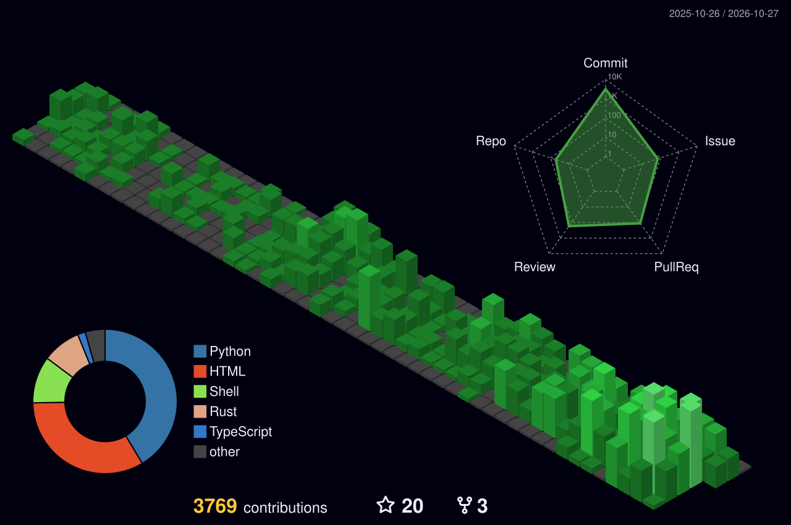

# vimkim

Neovim + LazyVim user and CLI/TUI maniac. I work on CUBRID and build tools for database debugging, CI investigation, and AI-assisted development.

Rust · C++ · Go · Linux

## Selected projects

| Project | What it helps with |
| --- | --- |
| [work-tracker](https://github.com/vimkim/work-tracker) | Keep work status and history across agent sessions. |
| [docserve](https://github.com/vimkim/docserve) | Browse HTML and Markdown documents from an SSH server. |
| [volmap](https://github.com/vimkim/volmap) | Explore CUBRID volumes, pages, files, and records offline. |
| [cubrid-ci](https://github.com/vimkim/cubrid-ci) | Collect CI evidence tied to a pull request's exact commit. |
| [herdr-next-to-current](https://github.com/vimkim/herdr-next-to-current) | Create adjacent Herdr Spaces and reorder workspaces. |

## How I work

- **Neovim + LazyVim** for editing, with CLIs and TUIs throughout the workflow.
- **Herdr** keeps project spaces and agent sessions together.
- **Codex and Claude Code** help with implementation, investigation, and documentation.
- **Small CLIs** connect the workflow: tracking work, inspecting CI evidence, and browsing the results.

*My daily workspace: project spaces on the left, the active agent session on the right.*

## All projects

Browse the full project catalog

Dates show the latest commit on each project's default branch (UTC), refreshed weekly.

### Database tools

- [csql-future](https://github.com/vimkim/csql-future) updated 2026-10-28 — Adds persistent searchable history, schema-aware completion, and multiline editing to CUBRID's CSQL client
- [cubrid-ci](https://github.com/vimkim/cubrid-ci) updated 2026-10-26 — Reports CUBRID pull-request status and collects exact-commit GitHub Actions evidence for `test_medium`, `test_sql`, and `test_shell` analysis
- [cubrid-conf-tui](https://github.com/vimkim/cubrid-conf-tui) updated 2026-10-23 — Terminal editor for CUBRID `[common]` configuration, with fuzzy search, parameter metadata, and validated edits where supported
- [cubrid-dev2-pr](https://github.com/vimkim/cubrid-dev2-pr) updated 2026-09-23 — CLI/TUI for tracking open CUBRID Dev2 teammate PRs with approval progress and review state
- [cubrid-dev2-server](https://github.com/vimkim/cubrid-dev2-server) updated 2026-10-26 — Dev server environment setup for CUBRID development
- [cubrid-ha-oneclick](https://github.com/vimkim/cubrid-ha-oneclick) updated 2025-12-10 — One-click CUBRID HA setup
- [cubrid-jira](https://github.com/vimkim/cubrid-jira) updated 2026-10-22 — Provides `cubrid-jira-search` utility for AI agent skills and automation
- [cubrid-logtopbind-rs](https://github.com/vimkim/cubrid-logtopbind-rs) updated 2025-02-08 — CLI utility that rebinds CUBRID broker logs
- [cubrid-memmondiff](https://github.com/vimkim/cubrid-memmondiff) updated 2025-01-24 — CLI utility for diffing memmon dumps
- [cubrid-oos-context](https://github.com/vimkim/cubrid-oos-context) updated 2026-10-27 — Authoritative CUBRID OOS project context docs consumed by AI agent skills
- [cubrid-oos-search](https://github.com/vimkim/cubrid-oos-search) updated 2026-03-30 — Semantic search over the CUBRID OOS knowledge vault (LlamaIndex + ChromaDB)
- [cubrid-oos-test](https://github.com/vimkim/cubrid-oos-test) updated 2026-06-15 — Simple test framework (just + shell automation) for CUBRID OOS project
- [cubrid-oos-vault](https://github.com/vimkim/cubrid-oos-vault) updated 2026-04-01 — CUBRID OOS knowledge vault published as a Quartz digital garden
- [cubrid-tc-chronicle](https://github.com/vimkim/cubrid-tc-chronicle) updated 2026-10-20 — CLI and read-only web UI for searching testcase failure history across CUBRID commits and GitHub Actions runs
- [cubrid-test-ai-reporter](https://github.com/vimkim/cubrid-test-ai-reporter) updated 2026-03-23 — AI-powered test result reporter for CUBRID
- [icsql-rs](https://github.com/vimkim/icsql-rs) updated 2025-10-19 — Interactive CSQL tool in Rust (WIP)
- [my-cubrid](https://github.com/vimkim/my-cubrid) updated 2026-10-28 — CUBRID-related utility scripts and settings
- [my-cubrid-dev-containers](https://github.com/vimkim/my-cubrid-dev-containers) updated 2025-02-19 — Dev Containers for CUBRID development
- [my-cubrid-docs](https://github.com/vimkim/my-cubrid-docs) updated 2026-10-28 — Personal knowledge base of CUBRID design notes and architecture docs
- [my-cubrid-doxygen](https://github.com/vimkim/my-cubrid-doxygen) updated 2025-09-15 — Personal Doxygen config for CUBRID source
- [my-cubrid-jira](https://github.com/vimkim/my-cubrid-jira) updated 2026-10-28 — CUBRID JIRA issues and drafts in Markdown
- [volmap](https://github.com/vimkim/volmap) updated 2026-09-11 — Read-only offline explorer for CUBRID volumes, pages, files, and records

### AI workflow tools

- [claude-code-docs](https://github.com/vimkim/claude-code-docs) updated 2026-04-13 — Claude Code study logs and references
- [docserve](https://github.com/vimkim/docserve) updated 2026-10-20 — Serve AI-generated HTML and Markdown from an SSH server with automatic port selection, document navigation, and file/content search
- [gh-pr-comments-fetch](https://github.com/vimkim/gh-pr-comments-fetch) updated 2026-07-28 — Export GitHub pull request comments into context-rich Markdown for AI-assisted review workflows
- [grill-tui](https://github.com/vimkim/grill-tui) updated 2026-09-29 — Terminal worksheet for quickly answering numbered AI questions and copying the responses back to chat
- [herdr-next-to-current](https://github.com/vimkim/herdr-next-to-current) updated 2026-10-23 — Python helper for creating adjacent Herdr Spaces and interactively reordering workspaces
- [lsp-cli](https://github.com/vimkim/lsp-cli) updated 2025-12-31 — CLI LSP client for simple querying and LLM automation (WIP)
- [my-cubrid-skills](https://github.com/vimkim/my-cubrid-skills) updated 2026-10-28 — AI agent skills for CUBRID development (JIRA lookup, PR review, CI failure analysis, test creation, and more)
- [my-skills](https://github.com/vimkim/my-skills) updated 2026-10-28 — General-purpose Codex and Claude Code skills for work tracking, PR reviews, documentation, and handoffs
- [work-tracker](https://github.com/vimkim/work-tracker) updated 2026-10-15 — Agent-friendly status ledger for parallel and long-running work (Rust CLI + read-only dashboard)

### Other projects

- [depthlog-cpp](https://github.com/vimkim/depthlog-cpp) updated 2026-01-21 — Depth logging library in C++
- [depthlog-rust](https://github.com/vimkim/depthlog-rust) updated 2026-01-16 — Depth logging library in Rust (WIP)
- [lazydiff-py](https://github.com/vimkim/lazydiff-py) updated 2025-08-18 — Interactive diff/patch TUI for two directories (WIP)
- [markdown-to-jira-confluence-online](https://github.com/vimkim/markdown-to-jira-confluence-online) updated 2025-01-09 — Convert Markdown to Jira Confluence Wiki Markup online, powered by Rust and WASM
- [my-git-utils](https://github.com/vimkim/my-git-utils) updated 2026-10-20 — Personal Git command-line utilities (`git-log`, `git-log-pick`, and `git-log-pr`)
- [patchers](https://github.com/vimkim/patchers) updated 2026-02-24 — TUI for interactively reviewing and slicing large diff/patch files
- [zellij-new-tab-next-to-current](https://github.com/vimkim/zellij-new-tab-next-to-current) updated 2026-06-22 — Zellij plugin to open new tabs next to the current tab
- [dirpick](https://github.com/vimkim/dirpick) updated 2026-10-19 — Rust TUI for file, directory, and content search with syntax previews, shell navigation, and editor integration

### Private and environment-specific tools

- [cubrid-qahome](https://github.com/vimkim/cubrid-qahome) updated 2026-07-23 — Python CLI for authenticated fetching and offline parsing of CUBRID QA portal pages (private)
- [cubrid-dev2-custom-watchdog](https://github.com/vimkim/cubrid-dev2-custom-watchdog) updated 2026-07-02 — Custom SSH and systemd watchdog guard for the dev2 server (private)
- [cubrid-dev2-pid-io-observability](https://github.com/vimkim/cubrid-dev2-pid-io-observability) updated 2026-07-02 — PID/process/cgroup-level I/O observability toolkit for dev2 incident attribution (private)
- [my-cubrid-justfiles](https://github.com/vimkim/my-cubrid-justfiles) updated 2026-07-15 — Personal per-ticket CUBRID justfiles (private)

### Deprecated projects

CUBRID CI is moving away from CircleCI; the older Markdown uploader is also deprecated.

- [codex-view](https://github.com/vimkim/codex-view) updated 2026-10-22 — Deprecated; use [herdr](https://github.com/herdrdev/herdr) and [herdr-web-ui](https://github.com/devswha/herdr-web-ui) instead to manage and view agent sessions
- [cubrid-ci-shell-queue-website](https://github.com/vimkim/cubrid-ci-shell-queue-website) updated 2026-09-08 — Live dashboard and agent-friendly CLI for monitoring the shared CircleCI `test_shell` queue and estimated wait times
- [cubrid-circleci-failcases-fetcher](https://github.com/vimkim/cubrid-circleci-failcases-fetcher) updated 2026-03-25 — CircleCI fail cases fetcher for CUBRID
- [cubrid-ini-fzf](https://github.com/vimkim/cubrid-ini-fzf) updated 2026-10-22 — Deprecated; use [cubrid-conf-tui](https://github.com/vimkim/cubrid-conf-tui) instead. The replacement currently edits `[common]`; broader section support is planned
- [md-to-jira-uploader](https://github.com/vimkim/md-to-jira-uploader) updated 2026-10-22 — Markdown to JIRA uploader for jira.cubrid.org

Notes and influences

> "What I cannot create, I do not understand" — Richard Feynman

- [How Neovim helped improve my productivity](https://kaustubhpatange.medium.com/how-neovim-helped-improve-my-productivity-4214dd099340)
- [Vim As Your Editor](https://www.youtube.com/watch?v=X6AR2RMB5tE&list=PLm323Lc7iSW_wuxqmKx_xxNtJC_hJbQ7R)
- [Before AI: my previous terminal setup](https://github.com/user-attachments/assets/89eb7758-6d95-47ed-8091-48a2f5444961)

Contribution activity

## Contact

[kimdhyungg@gmail.com](mailto:kimdhyungg@gmail.com)
