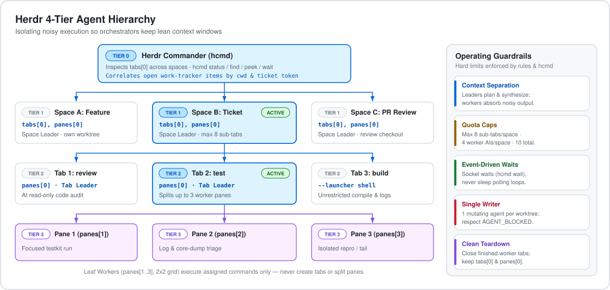

# Multi-Agent CLI Workflow & HITL Architecture

← Back to [profile README](../README.md)

This document explains how I run parallel database engineering, automated PR/CI orchestration, and Human-in-the-Loop (HITL) decision gates from the terminal.

The core idea is simple: **let AI agents and background daemons handle context gathering, builds, test replays, triage, and status routing—while keeping irreversible external actions behind explicit human gates.**

---

## 1. Herdr 4-Tier Agent Hierarchy

<picture>
  <source media="(prefers-color-scheme: dark)" srcset="../assets/herdr-hierarchy-dark.svg">
  <source media="(prefers-color-scheme: light)" srcset="../assets/herdr-hierarchy-light.svg">
  
</picture>

Instead of running one giant agent session across multiple branches and noisy test logs, work is partitioned into a strict 4-tier hierarchy inside [Herdr](https://github.com/herdrdev/herdr) and coordinated via [herdr-commander](https://github.com/vimkim/herdr-commander) (`hcmd`):

| Tier | Role | Location | Scope & Authority |
| --- | --- | --- | --- |
| **Tier 0** | **Herdr Commander** | Coordinating session (`hcmd`) | Inspects `tabs[0]` across Spaces, matches open [work-tracker](https://github.com/vimkim/work-tracker) items by `cwd`/ticket key, and dispatches work. |
| **Tier 1** | **Space Leader** | `tabs[0], panes[0]` per Space | Owns one ticket or review checkout; creates up to 8 scoped sub-tabs (`build`, `test`, `review`, `ci`). |
| **Tier 2** | **Tab Leader** | `tabs[1..8], panes[0]` | Owns one concern inside a Space; splits up to 3 worker panes (`2x2` grid). Never creates new tabs. |
| **Tier 3** | **Leaf Worker** | `panes[1..3]` | Executes assigned commands (builds, focused testkit runs, log tailing). Never creates tabs or splits panes. |

### Key Operating Invariants

- **Context-window hygiene:** Leaders plan, delegate, and synthesize; noisy compiler output, testkit logs, and stack traces stay isolated in worker tabs/panes so orchestrator context stays lean.
- **Quota & concurrency caps:** Up to **8 sub-tabs** per Space, **4 non-primary AI agents** per Space, and **10 working AI agents** session-wide (`--launcher shell` tabs for builds/tests are unrestricted within the 8-tab cap).
- **Event-driven waits, never `sleep`:** Agents subscribe to Herdr socket events (`hcmd wait`, `hcmd tab wait`, `hcmd pane wait`) rather than polling in shell `sleep` loops.
- **Single writer per worktree:** Only one mutating agent writes to a Git worktree at a time; `hcmd find` / `hcmd status --verify-busy` checks active or `AGENT_BLOCKED` panes before sending prompts.
- **Clean teardown:** Finished worker tabs and panes are closed automatically, leaving `tabs[0]` and `panes[0]` intact.

---

## 2. Closed-Loop Delivery: PR → Review → CI → Hermes → Discord → HITL

<picture>
  <source media="(prefers-color-scheme: dark)" srcset="../assets/pr-ci-hitl-loop-dark.svg">
  <source media="(prefers-color-scheme: light)" srcset="../assets/pr-ci-hitl-loop-light.svg">
  
</picture>

Each ticket flows through five stages combining interactive [my-cubrid-skills](https://github.com/vimkim/my-cubrid-skills) inside Herdr Spaces with `systemd --user` background daemons:

### Stage 1 — Ticket to Isolated Space

1. [cubrid-jira](https://github.com/vimkim/cubrid-jira) and [cubrid-xref](https://github.com/vimkim/cubrid-xref) resolve issue context and linked engine/testcase PRs.
2. [cubrid-worktree](https://github.com/vimkim/cubrid-worktree) creates a ticket-scoped Git worktree and dedicated Herdr Space, while [cubrid-workenv](https://github.com/vimkim/cubrid-workenv) isolates its installation prefix, databases, and runtime resources so parallel Spaces never collide.

### Stage 2 — Local Verification & Two-Step Draft PR

1. Implementation happens in **Neovim + LazyVim** alongside Codex / Claude Code sessions inside the ticket's Herdr Space, backed by local build and focused testkit skills (`cubrid-build`, `cubrid-testkit-run`).
2. `cubrid-pr-create` separates drafting from publishing:
   - **Step 1 (Autonomous):** Pins the source commit, writes structured PR materials and context in [my-cubrid-docs](https://github.com/vimkim/my-cubrid-docs), and validates links and formatting locally.
   - **Step 2 (HITL Gate `H1`):** Re-verifies remote target and commit fingerprint, then pushes and opens a `--draft` PR **only after explicit human confirmation**.

### Stage 3 — Autonomous Review & CI Orchestration

Once a draft PR is open, two `systemd --user` services run the verification loop without keeping an interactive agent pinned:

- `cubrid-pr-flow` *(private)* acts as the PR state machine: verifies testcase PR reviewers before triggering CI, runs code review and CI tracking in parallel, and applies an **AND-Join** gate before marking a PR ready to merge.
- [cubrid-ci-watch](https://github.com/vimkim/cubrid-ci-watch) tracks GitHub Actions `gha-ci` runs in a local SQLite ledger, blocks duplicate/conflicting `/run` triggers on the same HEAD, and emits structured run events.
- On CI failure, [cubrid-ci](https://github.com/vimkim/cubrid-ci), [cubrid-tc-chronicle](https://github.com/vimkim/cubrid-tc-chronicle), and [cubrid-tc-registry](https://github.com/vimkim/cubrid-tc-registry) classify failures against historical signatures:
  - **Confirmed known flake (`known_ci_issue`):** Automatically triggers at most **one** rerun per HEAD (`1x auto-rerun`).
  - **Real code defect or `changes-required` review:** Emits a `fix_in_herdr` action targeting the Space's `Tab 1` agent, which patches, re-tests locally, and pushes an updated HEAD to restart verification.

### Stage 4 — Idempotent Async Notification (`hermes-notify` → Discord)

- `hermes-notify` *(local service)* polls `cubrid-ci-watch` events and `cubrid-pr-flow` state through a single SQLite outbox with `dedupe_key` idempotency so retries never spam duplicate alerts.
- Event `kind` routing delivers concise status cards to Discord (early suite failure, final CI pass/fail, deadline reached, or merge-ready notice with direct Actions Run URLs) and records outcomes in [work-tracker](https://github.com/vimkim/work-tracker).
- If delivery confirmation is uncertain, the outbox marks the entry `unknown` and stops rather than risking a duplicate send, leaving final confirmation to the operator.

### Stage 5 — HITL Merge & Cleanup (`cubrid-pr-merge`)

Merge handoff is strictly manual—models never self-invoke merges:

1. **Read-only preflight (`plan`):** Verifies PR ownership (authenticated user must be both author and assignee), ensures zero unresolved review threads, runs dual approval checks across both engine and testcase repositories, and lints every squash commit message.
2. **HITL Gate (`H3`):** Displays the exact `plan` summary and squash commit messages; execution runs only with explicit `--yes` confirmation.
3. **Ordered execution (`execute`):** Merges (or closes if empty) linked testcase PRs first, reruns the TC Merge Gate until green, and then merges the engine PR.
4. **Cleanup (`cleanup --apply`):** Closes matching [work-tracker](https://github.com/vimkim/work-tracker) items, removes the implementation worktree, and runs explicit JIRA transitions (`Resolved` / `Fixed`) when requested.

---

## 3. Automation vs. HITL Boundaries

| Boundary | Autonomous (Agents & Daemons) | Human-in-the-Loop (Explicit Gate) |
| --- | --- | --- |
| **Workspace & Build** | Create ticket worktrees, isolated DBs, builds, focused testkit replays | Force-killing shared resources or non-standard environment overrides |
| **PR Drafting & Review** | Generate PR docs, run lint/link checks, run AI code reviews, precheck TC reviewers | Pushing branches and creating/opening PRs (`--draft` confirmation) |
| **CI Execution & Triage** | Watch `gha-ci` runs, collect logs, classify failures, `1x` auto-rerun on known flakes | Overriding base-sync blockers or forcing extra suite reruns |
| **Notifications & Ledger** | Route Discord cards via `hermes-notify`, log CI outcomes in `work-tracker` | Resolving `unknown` outbox states before any re-send |
| **Git Integration (Tiered)** | **Tier 1 (personal solo repos):** Rebase, `--ff-only` merge, push, and worktree cleanup once checks pass | **Tier 2 (upstream `CUBRID/*`):** Every merge, force-push, squash fallback, and external JIRA write |

---

## 4. Rule-Driven Automation (`my-cubrid-workflow` Pattern)

To prevent skills, CLIs, and background daemons from drifting apart, operational habits are managed in a private specification repository (`my-cubrid-workflow`) using a lightweight rule-to-code contract:

1. **One habit per Markdown rule (`rules/<id>.md`):** Each rule starts with 5-field YAML frontmatter (`id`, `status`, `trigger`, `impl_kind`, `impl_target`) followed by `## Trigger`, `## Requirement`, and `## Verification`.
2. **SHA-256 drift detection (`sync-lock.toml`):** Every synced rule's digest is pinned in `sync-lock.toml`. Editing a rule immediately surfaces `STALE` implementations via `just drift` until the code and tests catch up.
3. **Language-agnostic 4-recipe contract:** New local automations start in Python (`uv`) and can be rewritten in Rust or Go without touching the rule or orchestration layer, as long as the automation's `justfile` exposes four standard recipes:
   - `just check` — lint, type checks, and smoke checks
   - `just test` — behavior tests matching the rule's `## Verification` section
   - `just run` — single-shot execution
   - `just sync` — local binary or `systemd --user` service refresh

---

## 5. Toolbelt Map

| Stage | Tools & Repositories |
| --- | --- |
| **Orchestration & Tracking** | [herdr-commander](https://github.com/vimkim/herdr-commander) (`hcmd`), [work-tracker](https://github.com/vimkim/work-tracker), [docserve](https://github.com/vimkim/docserve) |
| **Ticket & Workspace Setup** | [cubrid-jira](https://github.com/vimkim/cubrid-jira), [cubrid-xref](https://github.com/vimkim/cubrid-xref), [cubrid-worktree](https://github.com/vimkim/cubrid-worktree), [cubrid-workenv](https://github.com/vimkim/cubrid-workenv) |
| **Skills & Editor** | [my-cubrid-skills](https://github.com/vimkim/my-cubrid-skills), [my-skills](https://github.com/vimkim/my-skills), [cubrid.nvim](https://github.com/vimkim/cubrid.nvim), [csql-future](https://github.com/vimkim/csql-future) |
| **CI, Evidence & Triage** | [cubrid-ci-watch](https://github.com/vimkim/cubrid-ci-watch), [cubrid-gha-monitor](https://github.com/vimkim/cubrid-gha-monitor), [cubrid-ci](https://github.com/vimkim/cubrid-ci), [cubrid-tc-chronicle](https://github.com/vimkim/cubrid-tc-chronicle), [cubrid-tc-registry](https://github.com/vimkim/cubrid-tc-registry) |
| **PR Flow, Notify & Merge** | `cubrid-pr-flow` *(private)*, `hermes-notify` *(local)*, `pr-final-merge-handoff` *(local)*, [gh-pr-comments-fetch](https://github.com/vimkim/gh-pr-comments-fetch) |
