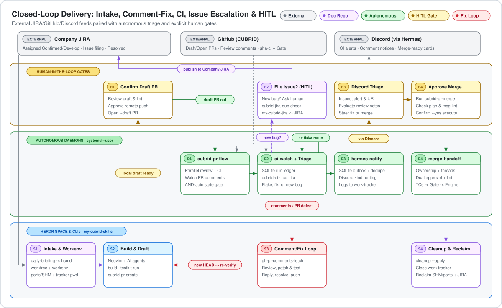

# Multi-Agent CLI Workflow & HITL Architecture

← Back to [profile README](../README.md)

This document details how I coordinate parallel database engineering, continuous ticket intake, automated PR/comment/CI orchestration, and explicit Human-in-the-Loop (HITL) decision gates from the terminal.

The core principle is clear separation of responsibilities: **external systems hold shared truth, document repos store reviewed drafts and rules, CLIs isolate environments and session state, background daemons run slow loops, and irreversible external actions pause for human confirmation.**

---

## 1. System Layers & Continuous Intake

<picture>
  <source media="(prefers-color-scheme: dark)" srcset="../assets/intake-and-layers-dark.svg">
  <source media="(prefers-color-scheme: light)" srcset="../assets/intake-and-layers-light.svg">
  
</picture>

Everything outside the core execution loop falls into four distinct layers:

1. **External Systems:** **Company JIRA** (assigned `Confirmed` / `Develop` issues, triage, new bug filings, and transitions), **GitHub** (draft/open PRs, inline and top-level review comments, `gha-ci` Actions, and Merge Gates), and **Discord** (asynchronous operator notifications with direct Actions URLs).
2. **Doc & Rule Repos:** Separate Git repositories hold durable Markdown artifacts before they touch external APIs—[my-cubrid-docs](https://github.com/vimkim/my-cubrid-docs) (PR bodies, CI failure reports, design notes), [my-cubrid-jira](https://github.com/vimkim/my-cubrid-jira) (structured Korean issue reports linted and pushed before JIRA publication), `my-cubrid-schedule` *(private)* (daily/weekly sheets), and `my-cubrid-workflow` *(private)* (habit rules + `sync-lock.toml`).
3. **Feature CLIs & Local State:** Focused single-purpose tools in Rust, Python, and Go ([work-tracker](https://github.com/vimkim/work-tracker), [cubrid-workenv](https://github.com/vimkim/cubrid-workenv), [cubrid-worktree](https://github.com/vimkim/cubrid-worktree), [cubrid-jira](https://github.com/vimkim/cubrid-jira), [cubrid-ci](https://github.com/vimkim/cubrid-ci), [gh-pr-comments-fetch](https://github.com/vimkim/gh-pr-comments-fetch)).
4. **Background Daemons (`systemd --user`):** `daily-briefing` *(in `my-cubrid-workflow`)*, `cubrid-pr-flow` *(private)*, [cubrid-ci-watch](https://github.com/vimkim/cubrid-ci-watch), and [hermes-notify](https://github.com/vimkim/hermes-notify).

### Continuous Intake Loop (`daily-briefing` → `Herdr Commander`)

Work does not start from a single prompt—it continuously flows in from external sources:

1. `daily-briefing` polls **Company JIRA** (`Confirmed`/`Develop`), open **GitHub** PRs/review queues, [work-tracker](https://github.com/vimkim/work-tracker), [cubrid-ci-watch](https://github.com/vimkim/cubrid-ci-watch), and live Herdr workspace state (`hcmd status`) in parallel.
2. It cross-matches every `CBRD-NNNNN` ticket against existing worktrees, open PRs, and active Herdr Spaces (`in_herdr`) so already-running work is never double-dispatched.
3. Ready tickets pass through `confirmed-issue-flow` to **Herdr Commander (`hcmd`)**, which spawns or routes a dedicated **Space Lead** (`tabs[0]`) for that ticket.

### `work-tracker`: `pwd`-Scoped Session Memory (Like `claude-mem`)

AI coding sessions frequently start fresh in a repository, hit context limits (`/compact`), or get reset (`/clear`). [work-tracker](https://github.com/vimkim/work-tracker) solves this by acting as a deterministic, **`pwd`-scoped source of truth** backed by SQLite WAL:

- Every work item captures its working directory (`cwd`), current status (`pending`, `active`, `waiting`, `blocked`, `done`, `cancelled`), latest notes, and immutable transition history.
- `work-tracker brief` emits a bounded resume brief for the current `cwd`, and `work-tracker hook session-start` plugs directly into `SessionStart` (`startup|clear|compact`).
- Whether you open a brand-new terminal in a directory or run `/clear` / `/compact` mid-investigation, the next turn immediately recovers what was tried, what is waiting on CI, and what step comes next.

### `cubrid-workenv`: Multiple Isolated CUBRID Environments on One Server

Running multiple database branches simultaneously on a single shared Linux host fails quickly if instances collide on runtime resources. [cubrid-workenv](https://github.com/vimkim/cubrid-workenv) solves single-host multi-env isolation per worktree:

- **Automatic allocation:** A host-wide registry assigns non-overlapping **master and broker TCP ports**, **broker SysV shared-memory (SHM/IPC) keys**, short TMP socket directories, dedicated install prefixes, and isolated database registries per worktree.
- **Automatic reclamation:** When a Space finishes and `cubrid-worktree delete` runs (or `cub-workenv reset` executes during post-merge cleanup), live `cub_*` processes are checked first and all allocated ports and SHM keys are cleanly released back to the host pool.

---

## 2. Herdr 4-Tier Agent Hierarchy

<picture>
  <source media="(prefers-color-scheme: dark)" srcset="../assets/herdr-hierarchy-dark.svg">
  <source media="(prefers-color-scheme: light)" srcset="../assets/herdr-hierarchy-light.svg">
  
</picture>

Instead of running one giant agent session across multiple branches and noisy test logs, work is partitioned into a strict 4-tier hierarchy inside [Herdr](https://github.com/herdrdev/herdr) and coordinated via [herdr-commander](https://github.com/vimkim/herdr-commander) (`hcmd`):

| Tier | Role | Location | Scope & Authority |
| --- | --- | --- | --- |
| **Tier 0** | **Herdr Commander** | Coordinating session (`hcmd`) | Consumes `daily-briefing` & [work-tracker](https://github.com/vimkim/work-tracker) `pwd` state; inspects `tabs[0]` across Spaces; spawns and routes Space Leads. |
| **Tier 1** | **Space Lead** | `tabs[0], panes[0]` per Space | Owns one ticket or review checkout with its own `cubrid-workenv` isolation; creates up to 8 scoped sub-tabs (`build`, `test`, `review`, `ci`). |
| **Tier 2** | **Tab Lead** | `tabs[1..8], panes[0]` | Owns one concern inside a Space (`Tab 1` handles `fix_in_herdr` & PR comment fixes); splits up to 3 worker panes (`2x2` grid). Never creates new tabs. |
| **Tier 3** | **Pane Worker** | `panes[1..3]` | Executes assigned commands (compiles, focused testkit runs, log tailing). Never creates tabs or splits panes. |

### Key Operating Invariants

- **Context-window hygiene:** Leads plan, delegate, and synthesize; noisy compiler output, testkit logs, and stack traces stay isolated in worker tabs/panes so orchestrator context stays lean.
- **Quota & concurrency caps:** Up to **8 sub-tabs** per Space, **4 non-primary AI agents** per Space, and **10 working AI agents** session-wide (`--launcher shell` tabs for builds/tests are unrestricted within the 8-tab cap).
- **Event-driven waits, never `sleep`:** Agents subscribe to Herdr socket events (`hcmd wait`, `hcmd tab wait`, `hcmd pane wait`) rather than polling in shell `sleep` loops.
- **Single writer per worktree:** Only one mutating agent writes to a Git worktree at a time; `hcmd find` / `hcmd status --verify-busy` checks active or `AGENT_BLOCKED` panes before sending prompts.
- **Clean teardown:** Finished worker tabs and panes are closed automatically, leaving `tabs[0]` and `panes[0]` intact; environment ports and SHM keys are reclaimed on worktree deletion.

---

## 3. Closed-Loop Delivery: Intake, Comment-Fix, CI, Issue Escalation & HITL

<picture>
  <source media="(prefers-color-scheme: dark)" srcset="../assets/pr-ci-hitl-loop-dark.svg">
  <source media="(prefers-color-scheme: light)" srcset="../assets/pr-ci-hitl-loop-light.svg">
  
</picture>

Each ticket flows through a closed loop across Herdr Spaces, local feature CLIs, background daemons, and explicit HITL gates:

### Stage 1 — Intake & Isolated Environment (`S1`)

1. `daily-briefing` and [cubrid-jira](https://github.com/vimkim/cubrid-jira) / [cubrid-xref](https://github.com/vimkim/cubrid-xref) pull assigned tickets and linked PRs from **Company JIRA** and **GitHub**.
2. [cubrid-worktree](https://github.com/vimkim/cubrid-worktree) + [cubrid-workenv](https://github.com/vimkim/cubrid-workenv) allocate a ticket worktree, dedicated Herdr Space, and isolated TCP ports + SysV SHM keys on the shared host.
3. [work-tracker](https://github.com/vimkim/work-tracker) provides the `pwd`-scoped resume brief so the Space Lead starts with full context.

### Stage 2 — Build & Two-Step Draft PR (`S2` → `H1`)

1. Implementation runs in **Neovim + LazyVim** with Codex / Claude Code / Antigravity inside the Space, verified via `cubrid-build` and focused native testkits (`cubrid-test-sql-run`, `cubrid-test-medium-run`, `cubrid-test-shell-run`).
2. `cubrid-pr-create` splits drafting from publishing:
   - **Local draft:** Pins `SOURCE_COMMIT`, writes structured PR materials in [my-cubrid-docs](https://github.com/vimkim/my-cubrid-docs), and runs lint/link checks.
   - **HITL Gate (`H1`):** Pushes and opens a `--draft` PR on **GitHub** **only after explicit human confirmation**.

### Stage 3 — Autonomous Review, PR Comment-Fix Loop & CI Triage (`D1`, `D2`, `S3`, `H2`)

1. `cubrid-pr-flow` *(private)* and [cubrid-ci-watch](https://github.com/vimkim/cubrid-ci-watch) track **GitHub** AI/human review state, PR comments, and `gha-ci` runs in parallel using an **AND-Join** gate.
2. When CI fails, [cubrid-ci](https://github.com/vimkim/cubrid-ci), [cubrid-tc-chronicle](https://github.com/vimkim/cubrid-tc-chronicle), and [cubrid-tc-registry](https://github.com/vimkim/cubrid-tc-registry) classify failures:
   - **Confirmed known flake (`known_ci_issue`):** Automatically triggers at most **one** rerun per HEAD (`1x flake rerun`).
   - **PR Review Comments & Defect Fix Loop (`S3`):** When reviewers post comments on GitHub or CI reports a PR defect, [gh-pr-comments-fetch](https://github.com/vimkim/gh-pr-comments-fetch) exports inline review comments, top-level review summaries, and conversation threads into context-rich Markdown. `fix_in_herdr` wakes the Space's `Tab 1` agent to evaluate every comment, apply verified fixes, re-run local tests, reply/resolve threads as appropriate, and push an updated HEAD—restarting Review + CI automatically.
   - **New Problem Discovery → HITL Issue Escalation (`H2`):** If investigation or CI triage uncovers an unrelated or pre-existing bug, the workflow **asks the human whether to file it as an issue**. On approval, [cubrid-jira-duplicate](https://github.com/vimkim/cubrid-jira-duplicate) checks for duplicates, the report is drafted and pushed in [my-cubrid-jira](https://github.com/vimkim/my-cubrid-jira), and [cubrid-jira](https://github.com/vimkim/cubrid-jira) (`--yes`) publishes the new issue to **Company JIRA** while linking any failing testcase in [cubrid-tc-registry](https://github.com/vimkim/cubrid-tc-registry).

### Stage 4 — Idempotent Async Notification (`D3`: `hermes-notify` → Discord → `H3`)

- [hermes-notify](https://github.com/vimkim/hermes-notify) polls `cubrid-ci-watch` and `cubrid-pr-flow` through a single SQLite outbox with `dedupe_key` idempotency so retries never spam duplicate alerts.
- Event `kind` routing delivers concise status cards to **Discord** (early suite failure, comment/review notices, final CI pass/fail, merge-ready notice with direct Actions Run URLs) and records outcomes back into [work-tracker](https://github.com/vimkim/work-tracker).
- Uncertain delivery states stay `unknown` rather than double-sending until resolved manually.

### Stage 5 — HITL Merge, Cleanup & Resource Reclamation (`H4` → `D4` → `S4`)

Merge handoff is strictly manual—models never self-invoke merges:

1. **Read-only preflight (`plan`):** Verifies PR ownership (author + assignee), zero unresolved review threads, dual approval checks across engine + testcase repos, and squash commit message linting.
2. **HITL Gate (`H4`):** Displays the `plan` summary and exact squash commit messages; execution runs only with explicit `--yes` confirmation.
3. **Ordered execution (`D4`):** Merges (or closes if empty) linked testcase PRs first, reruns the TC Merge Gate until green, and then merges the engine PR.
4. **Cleanup & Reclamation (`S4`):** Closes matching [work-tracker](https://github.com/vimkim/work-tracker) entries, runs `cub-workenv reset` + `cubrid-worktree delete` to reclaim host TCP ports, SysV SHM keys, and install dirs, and transitions the **Company JIRA** ticket to `Resolved` (`Fixed`) when requested.

---

## 4. Automation vs. HITL Boundaries

| Area | Autonomous (Agents & Daemons) | Human-in-the-Loop (Explicit Gate) |
| --- | --- | --- |
| **Continuous Intake & Memory** | Poll JIRA/GitHub/ledger via `daily-briefing`; inject `work-tracker` `pwd` brief on `startup\|clear\|compact` | Selecting non-standard priorities or overriding `AGENT_BLOCKED` Spaces |
| **Host Environment Isolation** | Allocate & reclaim per-worktree ports, SysV SHM keys, sockets, and DBs via `cubrid-workenv` | Force-killing active `cub_*` daemons when `--force` is needed |
| **PR Drafting & Comment Fixes** | Draft PR bodies in `my-cubrid-docs`, fetch comments via `gh-pr-comments-fetch`, patch & test in `Tab 1` | Confirming remote push & `--draft` PR creation (`H1`); resolving disputed review threads |
| **CI Triage & Issue Escalation** | Classify failures, `1x` auto-rerun on known flakes, run duplicate checks with `cubrid-jira-duplicate` | Deciding whether to file a newly discovered bug to **Company JIRA** (`H2` + `--yes` publish) |
| **Notifications & Ledger** | Route Discord cards via `hermes-notify`; log CI outcomes in `work-tracker` | Resolving `unknown` outbox delivery states before any re-send |
| **Git Integration (Tiered)** | **Tier 1 (personal solo repos):** Rebase, `--ff-only` merge, push, and worktree cleanup once checks pass | **Tier 2 (upstream `CUBRID/*`):** Every merge (`H4`), force-push, squash fallback, and external JIRA write |

---

## 5. Rule-Driven Automation (`my-cubrid-workflow` Pattern)

To keep skills, CLIs, and background daemons aligned as the workflow evolves, operational habits are maintained in a private specification repository (`my-cubrid-workflow`) using a rule-to-code contract:

1. **One habit per Markdown rule (`rules/<id>.md`):** Each rule opens with 5-field YAML frontmatter (`id`, `status`, `trigger`, `impl_kind`, `impl_target`) followed by `## Trigger`, `## Requirement`, and `## Verification`.
2. **SHA-256 drift detection (`sync-lock.toml`):** Every synced rule's digest is pinned in `sync-lock.toml`. Editing a rule flags `STALE` implementations via `just drift` until code and tests catch up.
3. **Language-agnostic 4-recipe contract:** New automations start in Python (`uv`) and can be rewritten in Rust or Go without changing the rule or orchestration layer, as long as `automations/<id>/justfile` implements:
   - `just check` — lint, type checks, and smoke checks
   - `just test` — behavior tests matching `## Verification`
   - `just run` — single-shot execution
   - `just sync` — local binary or `systemd --user` refresh

---

## 6. Component Taxonomy

| Layer | Components |
| --- | --- |
| **External Systems** | Company JIRA (`jira.cubrid.org`), GitHub (`CUBRID/*` PRs, comments, `gha-ci`), Discord |
| **Doc & Rule Repos** | [my-cubrid-docs](https://github.com/vimkim/my-cubrid-docs), [my-cubrid-jira](https://github.com/vimkim/my-cubrid-jira), `my-cubrid-schedule` *(private)*, `my-cubrid-workflow` *(private)* |
| **Session & Host State CLIs** | [work-tracker](https://github.com/vimkim/work-tracker), [cubrid-workenv](https://github.com/vimkim/cubrid-workenv), [cubrid-worktree](https://github.com/vimkim/cubrid-worktree), [herdr-commander](https://github.com/vimkim/herdr-commander) |
| **Domain CLIs & Skills** | [my-cubrid-skills](https://github.com/vimkim/my-cubrid-skills), [my-skills](https://github.com/vimkim/my-skills), [cubrid-jira](https://github.com/vimkim/cubrid-jira), [cubrid-jira-duplicate](https://github.com/vimkim/cubrid-jira-duplicate), [cubrid-xref](https://github.com/vimkim/cubrid-xref), [cubrid-ci](https://github.com/vimkim/cubrid-ci), [cubrid-tc-chronicle](https://github.com/vimkim/cubrid-tc-chronicle), [cubrid-tc-registry](https://github.com/vimkim/cubrid-tc-registry), [gh-pr-comments-fetch](https://github.com/vimkim/gh-pr-comments-fetch) |
| **Background Daemons** | `daily-briefing` *(in `my-cubrid-workflow`)*, `cubrid-pr-flow` *(private)*, [cubrid-ci-watch](https://github.com/vimkim/cubrid-ci-watch), [hermes-notify](https://github.com/vimkim/hermes-notify), `pr-final-merge-handoff` *(in `my-cubrid-workflow`)* |
